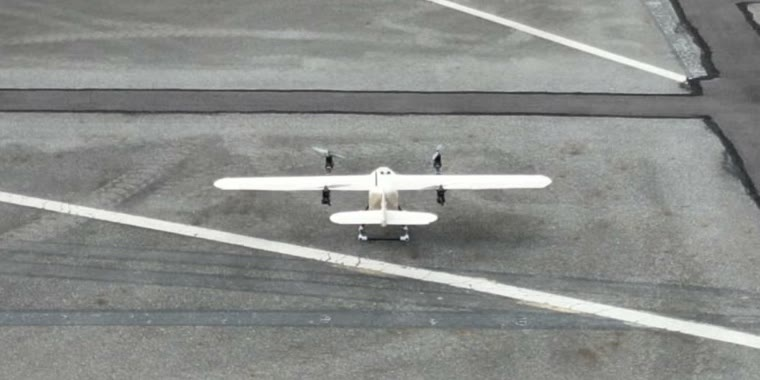
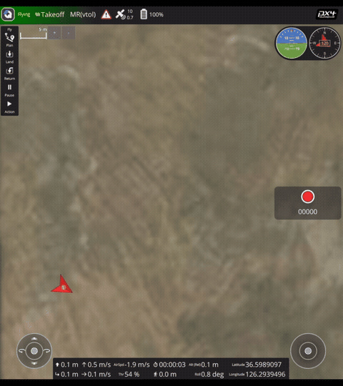
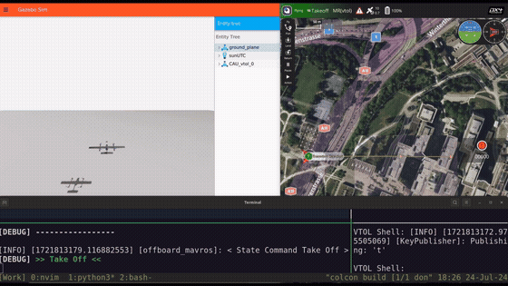
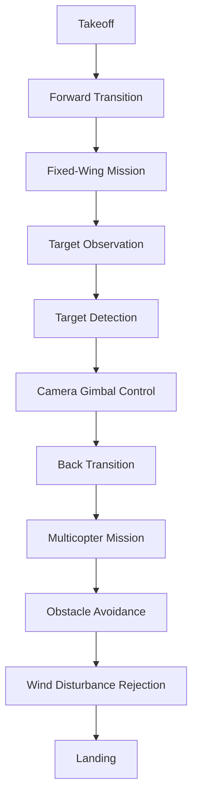

# KRAC – Autonomous VTOL Aircraft Development

> Design, integration, and validation of an autonomous VTOL aircraft for the **Korean Robot Aircraft Competition (KRAC)** using **ROS2, PX4, MAVROS, vector field guidance, mission management, and autonomous flight control**.

> Korea Robot Aircraft Competition (KRAC) · 22nd (2024) and 23rd (2025) · MACH eVTOL team, Chung-Ang University aerospace club (17 members in 2025) · the code in this repo is mainly from the 2024 season

## Highlights

| ROS2 Gazebo Simulation | Real VTOL Takeoff Test | Waypoint Flight (Test Quadcopter) |
|:----------------------:|:---------------------:|:--------------------------:|
|  |  |  |


## Project Focus

<p align="center">
  
  
  
  
  
</p>

## Overview

This project presents the end-to-end development of an autonomous VTOL aircraft for the Korean Robot Aircraft Competition (KRAC).

The project covered the full engineering workflow, including aircraft design, aerodynamic analysis, onboard electronic integration, autonomous flight software development, guidance and control, mission management, simulation validation, and real flight testing.

The final system was designed to execute autonomous takeoff, forward transition, fixed-wing flight, target observation, back transition, multicopter mission execution, obstacle avoidance, disturbance rejection, and landing.

---

## Technology Stack

| Flight Control | Robotics | Guidance & Planning | Perception | Programming |
|:--------------:|:--------:|:-------------------:|:----------:|:-----------:|
| PX4 | ROS2 | Vector Field Guidance | OpenCV | C++ |
| MAVROS | Gazebo | Mission Planning | Camera System | Python |
| QGroundControl | RViz | Path Following | Gimbal Control | MATLAB |

---


## Project Summary

- Designed and built a custom autonomous VTOL aircraft from prototype development to real flight testing.
- Developed a ROS2–PX4 autonomous flight framework.
- Implemented autonomous mission protocols for VTOL operation.
- Integrated vector field guidance into the flight system.
- Performed aerodynamic analysis using CFD, OpenVSP, and XFLR5.
- Validated the autonomous mission and vector field guidance in PX4 SITL (Gazebo) with the team's own aircraft model.
- Ran ground thrust tests and outdoor flight tests on the real aircraft; in 2024 the full autonomous mission was tested only in simulation.

---


<p align="center">
  
</p>

The KRAC team developed a custom VTOL aircraft capable of autonomously executing competition missions requiring both fixed-wing and multicopter flight.

The project involved the entire engineering workflow, from conceptual aircraft design and aerodynamic analysis to onboard electronics integration, autonomous software development, simulation-based verification, and outdoor flight testing.

---
## My Contributions

### Autonomous Flight Software

- Developed a ROS2-based autonomous mission framework for a PX4-controlled VTOL aircraft.
- Implemented the complete autonomous mission protocol, including takeoff, waypoint navigation, forward transition, fixed-wing flight, back transition, multicopter operation, and autonomous landing.
- Developed mission state management for reliable autonomous mission execution.

### Guidance Integration

- Integrated an existing vector field guidance algorithm into the autonomous VTOL flight framework.
- Implemented waypoint-following and mission sequencing using the vector field guidance module.
- Verified guidance performance through ROS2 simulation and outdoor flight testing.

### VTOL Simulation

- Built a ROS2–PX4 SITL simulation environment for autonomous VTOL development.
- Implemented MAVROS communication between the companion computer and the PX4 flight controller.
- Validated autonomous mission logic through simulation before real flight experiments.

### System Integration

- Integrated onboard sensors, telemetry, cameras, and companion computing into the autonomous flight system.
- Developed ROS2 nodes for mission management and hardware interfaces.
- Participated in aircraft integration, field deployment, and autonomous mission validation.

---


## Vector Field Guidance

<p align="center">
  
</p>
<p align="center"><sub>PX4 SITL, multicopter mode: straight-line and circular path following with vector field velocity commands (sped up 8x).</sub></p>

Instead of sending raw waypoints to PX4, the mission node sends velocity commands from a vector field that pulls the aircraft onto the path and moves it along it (based on Gonçalves et al., IEEE T-RO 2010).

- **Path as manifolds:** a 3D path is the intersection of two surfaces. A straight line uses a longitudinal and a lateral plane; a circular path uses a cylinder and a horizontal plane.
- **Guidance law:** `u = -K1 ∂V/∂r + K2 (∂α1/∂r × ∂α2/∂r)`, where `V = ½(α1² + α2²)`. The first term converges to the path, the second moves along it.
- **Obstacle avoidance:** an obstacle seen by the RGB-D camera is wrapped in a cylinder manifold, and the aircraft is guided around it.
- **Crosswind landing:** a vertical path (two planes with N and E normals) keeps the aircraft above the landing point until the final land command.

Code: `StraightPath`, `CircularPath`, `WaypointManager` in `ws_sensor_combined_src/src/px4_ros_com/src/lib/`.

---

## Simulation Environment

<p align="center">
  
</p>

Before real-world flight experiments, the complete autonomous mission workflow was validated through a simulation environment.

<p align="center">
  
</p>
<p align="center"><sub>Gazebo + QGroundControl: takeoff, forward transition, back transition and landing of the team's VTOL model, driven by the ROS2/MAVROS mission node (sped up 7.6x).</sub></p>

The Gazebo model (`CAU_vtol`) uses the team's own mass, inertia and aerodynamic coefficients from CFD, OpenVSP and XFLR5 instead of the stock PX4 VTOL.

### Simulation Features

- ROS2-based autonomous mission system
- PX4 SITL simulation
- MAVROS communication interface
- Mission sequence verification
- Vector field guidance validation
- Controller performance evaluation
- Pre-flight logic testing before outdoor experiments

---

## Mission System Architecture

<p align="center">
  
</p>

The autonomous mission system coordinates flight control, mission management, object detection, communication, and camera operation through a ROS2-based software architecture.

### Major Components

- Autonomous Mission Manager
- PX4 Flight Controller
- ROS2 Mission Nodes
- MAVROS Interface
- Mission State Machine
- Object Detection Module
- Camera Gimbal Control
- Telemetry and Communication System

Mission states are stored as a 16-bit status command (bit masks for check, arm, takeoff, transition, mission and land), updated from `/mavros/state` and `/mavros/extended_state`.

---

## Electronic System Integration

<p align="center">
  
</p>

The onboard electronic architecture integrates flight control hardware, companion computing, sensors, cameras, communication devices, and power management into a unified autonomous platform.

### Hardware Components

- Pixhawk Cube Orange flight controller
- Raspberry Pi 4B companion computer in 2024 (Ubuntu 22.04, ROS2 Humble, MAVROS); Jetson Nano in 2025
- GPS (HERE3, RTK capable)
- Telemetry Radio
- Pitot tube
- RGB-D camera
- 2-axis camera gimbal (servos)
- ESC
- Power board
- Main battery and separate mission battery (5V BEC)

---

## Prototype Design Evolution

<p align="center">
  
</p>

Prototype 2 was developed by improving the limitations identified during the flight tests of Prototype 1. The redesigned airframe improved structural reliability, flight stability, and mission performance.

### Key Improvements

- Improved wing attachment mechanism
- Pusher propulsion configuration
- Redesigned tail structure
- Enhanced quadrotor stability
- Passenger cabin integration
- Improved maintainability for field testing

---

## Control Surface Design and Aerodynamic Analysis

The control surface was designed through an integrated workflow combining aerodynamic simulation, analytical modeling, and mechanical linkage analysis.

First, aerodynamic characteristics were evaluated using CFD, OpenVSP, and XFLR5 to estimate lift, drag, and stability derivatives. These results were incorporated into the aircraft dynamic equations to determine the required control authority.

Based on the desired roll and pitch performance, the practical control surface deflection range was calculated, and the neutral servo position was calibrated to maximize usable servo travel while avoiding mechanical saturation.

Finally, a 2D servo linkage kinematic analysis was performed to optimize the horn geometry and linkage ratio before applying the design to the actual aircraft.

<p align="center">
  
</p>

### Design Workflow

```text
Aerodynamic Analysis
        │
        ▼
CFD / OpenVSP / XFLR5
        │
        ▼
Aircraft Dynamic Model
        │
        ▼
Required Control Authority
        │
        ▼
Control Surface Deflection Range
        │
        ▼
Servo Neutral Calibration
        │
        ▼
2D Linkage Kinematic Analysis
        │
        ▼
Final Aircraft Application
```

Key Contributions

* Performed aerodynamic analysis using CFD, OpenVSP, and XFLR5.
* Estimated aerodynamic coefficients for control surface sizing.
* Calculated practical control surface deflection limits.
* Optimized the neutral servo angle for maximum usable authority.
* Designed servo horn and linkage geometry through 2D kinematic analysis.
* Applied the optimized control surface mechanism to the final VTOL aircraft.

### Ground Test Results

- Thrust tests on a test rig: thrust-to-weight ratio of about 1.5–2 in multicopter mode and about 0.7 in fixed-wing mode, enough to fly.
- Prototype 1 crashed in 2024 after a power-board capacitor failure; Prototype 2 uses a different power board.

---

## FCU Mission Workflow

<p align="center">
  
</p>

The Flight Control Unit (FCU) autonomously manages the complete mission sequence from takeoff to landing while coordinating fixed-wing flight, multicopter flight, perception, and obstacle avoidance.

### Mission Sequence



---

## Repository Structure

```text
.
├── ws_sensor_combined_src/src/
│   ├── px4_ros_com/            # mission package
│   │   ├── src/main/           # offboard_mavros (mission node), key_event_pub, position subscribers
│   │   ├── src/lib/            # OffboardMavros/, StraightPath, CircularPath, Dubins, WaypointManager
│   │   ├── include/            # headers
│   │   └── src/PRACTICE, BACKUP # early tests and old versions
│   ├── key_event/              # keyboard command node (VTOL shell)
│   ├── px4_msgs/               # PX4 message definitions
│   └── px4-ros2-interface-lib/ # PX4 ROS2 interface library
├── PX4-Autopilot/              # Gazebo models and worlds (CAU_vtol, OakD-Lite camera)
├── MAVROS/                     # SITL / HILS launch files
├── Bashes/                     # build and run commands
└── websocket/                  # Python WebSocket test scripts (server/client)
```
